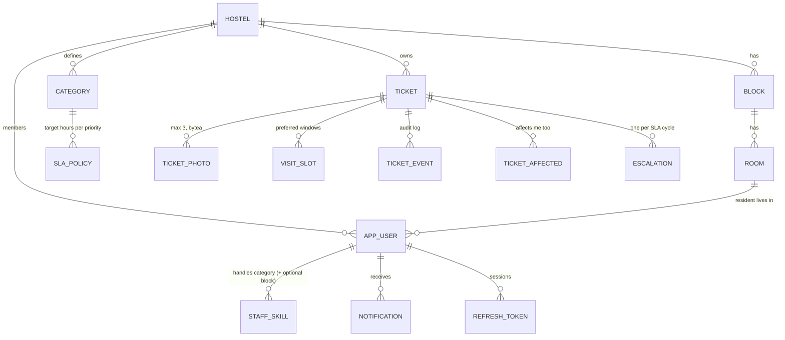
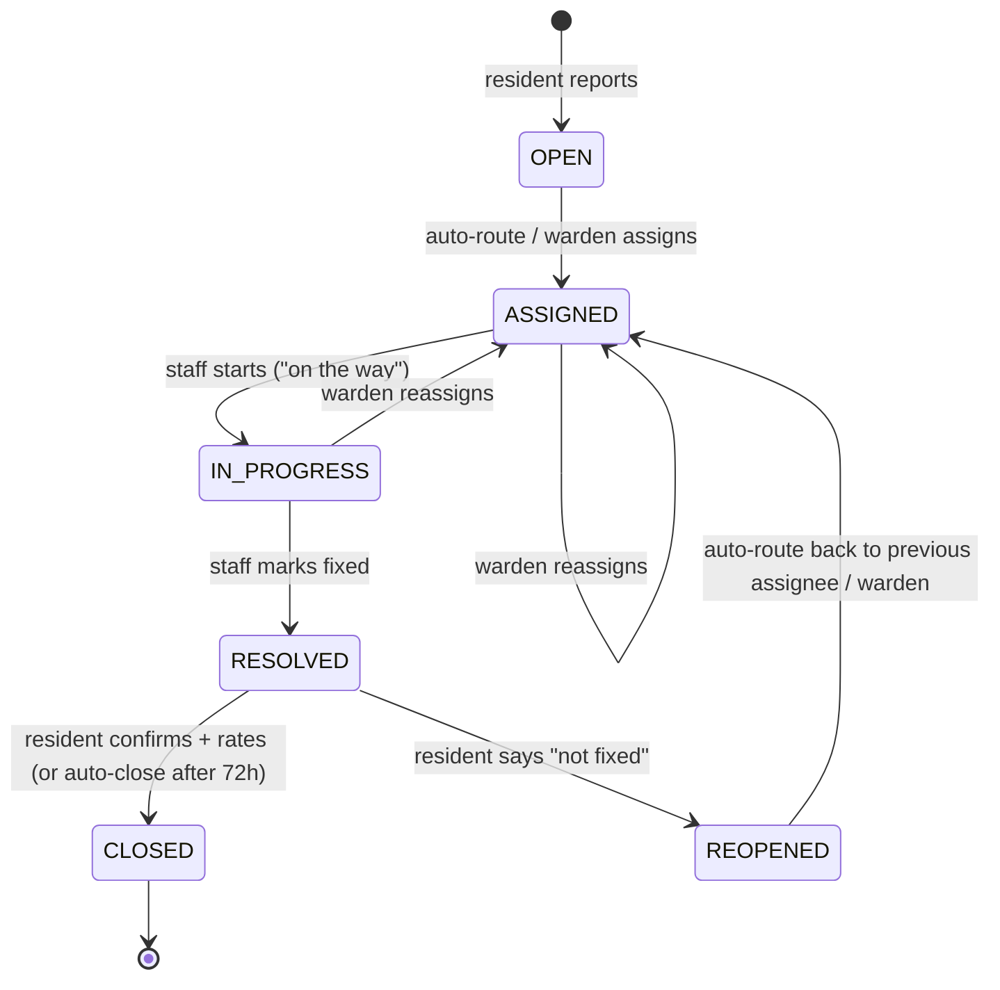

# FixIt — build plan (for approval)

## 1. Domain model

Every tenant-owned table carries `hostel_id` (FK, NOT NULL, indexed). In v1 a user belongs to exactly one hostel.



| Table | Key columns | Constraints / indexes |
|---|---|---|
| `hostel` | name, kind (HOSTEL/CAMPUS/SOCIETY), resident_invite_code, staff_invite_code | invite codes UNIQUE |
| `block` | hostel_id, name | UNIQUE(hostel_id, name) |
| `room` | hostel_id, block_id, number | UNIQUE(block_id, number) |
| `category` | hostel_id, code (PLUMBING…MESS), name, covers (short line), active | UNIQUE(hostel_id, code) |
| `sla_policy` | hostel_id, category_id, priority, target_hours | UNIQUE(category_id, priority), CHECK target_hours > 0 |
| `app_user` | email (citext), password_hash (BCrypt), name, hostel_id, role (RESIDENT/STAFF/WARDEN), room_id | UNIQUE(email) |
| `staff_skill` | staff_id, category_id, block_id NULL (= all blocks) | UNIQUE(staff_id, category_id, block_id) |
| `ticket` | hostel_id, number (per-hostel sequence), reporter_id, category_id, block_id, room_id NULL, common_area bool, description, priority (LOW/NORMAL/URGENT), status, assignee_id, **version** (@Version), sla_due_at, sla_cycle, sla_breached_at, rating, timestamps | UNIQUE(hostel_id, number); idx (hostel_id, status), (assignee_id, status), (room_id, category_id, status), partial idx on sla_due_at WHERE status open |
| `ticket_photo` | ticket_id, hostel_id, content_type, bytes (bytea), size_bytes | CHECK size_bytes <= 524288, CHECK content_type IN (jpeg, webp) |
| `visit_slot` | ticket_id, day, window (MORNING/AFTERNOON/EVENING) | UNIQUE(ticket_id, day, window) |
| `ticket_event` | ticket_id, hostel_id, actor_id, type, from_status, to_status, details jsonb, created_at | idx (ticket_id, created_at); append-only |
| `ticket_affected` | ticket_id, user_id, created_at | PK(ticket_id, user_id) → idempotent "affects me too" |
| `escalation` | ticket_id, sla_cycle, escalated_to, created_at | **UNIQUE(ticket_id, sla_cycle)** → never escalates the same breach twice |
| `notification` | user_id, hostel_id, ticket_id, type, message, read_at | idx (user_id, read_at, created_at desc) |
| `refresh_token` | user_id, token_hash (SHA-256), family_id, expires_at, revoked_at | UNIQUE(token_hash) |
| `usage_counter` | day, action, count | PK(day, action); counts only, no user ids |

All schema changes via Flyway (`V1__init.sql`, …); Hibernate `ddl-auto=validate`.

## 2. Ticket state machine



- Implemented as a Java `enum TicketStatus` with a transition table (`EnumMap<TicketStatus, Set<TicketStatus>>`) + who may trigger each transition (reporter / assignee / warden / system). Anything else → `IllegalTransitionException` → HTTP 409 with a clear message.
- Every transition writes a `ticket_event` row in the same DB transaction (who, from, to, when, note).
- `@Version` on `Ticket`: two staff updating the same ticket → second gets HTTP 409 "This ticket was updated by someone else — refresh".
- Resident timeline: reported = OPEN, assigned = ASSIGNED, on the way = IN_PROGRESS, fixed = RESOLVED/CLOSED.

## 3. Security design

- **Auth**: email + password (BCrypt, strength 12). Login sets two **httpOnly, Secure, SameSite=Lax** cookies:
  - `fx_at` — JWT access token (HS256, 15 min), claims: `sub` userId, `hid` hostelId, `role`.
  - `fx_rt` — opaque refresh token (14 days, path `/api/auth`), stored only as a SHA-256 hash. **Rotation on every refresh; reuse of an old token revokes the whole family** (stolen-token detection).
- **Same-origin in prod**: Vercel rewrites `/api/*` to the Render backend, so the browser sees one origin → cookies stay SameSite=Lax, no third-party-cookie problems, CORS stays closed.
- **CSRF**: Spring Security double-submit cookie (`XSRF-TOKEN` cookie → `X-XSRF-TOKEN` header) on all mutating requests.
- **Roles**: `RESIDENT`, `STAFF`, `WARDEN`, plus `PLATFORM_ADMIN` granted at login when the email is in `ADMIN_EMAILS`. Method-level security with `@EnableMethodSecurity` + `@PreAuthorize` on service methods (e.g. `hasRole('WARDEN')`), plus object-level checks (a resident sees own tickets + common-area tickets in their hostel; staff see tickets assigned to them or in their categories).
- **Hostel isolation**: the `hostelId` comes only from the verified JWT, never from the request body/URL. Every tenant repository method takes `hostelId` (`findByIdAndHostelId`, …) — there is no plain `findById` on tenant entities. Cross-tenant access returns **404** (doesn't reveal the ticket exists). Testcontainers tests create two hostels and hit every endpoint cross-tenant.
- Rate limit on login/register (in-memory bucket per IP+email), generic "wrong email or password" message, password min 8 chars.
- Bean Validation on all DTOs, global `@RestControllerAdvice` → consistent error body `{ status, code, message, fieldErrors[], traceId }`.
- Photos: size + magic-byte check server-side (not trusting Content-Type), served with auth and `Cache-Control: private`.

## 4. API (all under `/api`, Swagger UI at `/docs`)

| Method & path | Who | Purpose |
|---|---|---|
| POST `/auth/register` · `/auth/login` · `/auth/refresh` · `/auth/logout` | public / any | account + cookie session |
| GET `/me` · PATCH `/me` | any | profile, room |
| POST `/hostels` | signed-in, no hostel | create hostel → caller becomes WARDEN |
| POST `/hostels/join` `{code}` | signed-in, no hostel | join as resident or staff (code decides) |
| GET/PUT `/hostel` · POST `/hostel/invite-codes/rotate` | WARDEN | settings, rotate codes |
| CRUD `/hostel/blocks`, `/hostel/blocks/{id}/rooms` (bulk "101-120") | WARDEN | layout |
| GET/PUT `/hostel/categories`, `/hostel/sla-policies` | WARDEN (GET: all) | categories + SLA targets |
| GET `/hostel/staff` · PUT `/hostel/staff/{id}/skills` | WARDEN | staff + routing skills |
| GET `/tickets/duplicate-check?categoryId&roomId` | RESIDENT | warn before creating duplicate |
| POST `/tickets` (multipart: JSON + ≤3 photos) | RESIDENT | raise complaint (idempotency key header) |
| GET `/tickets?status&category&block&assignee&mine&page` | all (scoped) | lists, paginated |
| GET `/tickets/common?block` | all | open common-area issues |
| GET `/tickets/{id}` · `/tickets/{id}/events` · `/tickets/{id}/photos/{pid}` | scoped | detail, audit log, photo |
| POST `/tickets/{id}/affects-me` · DELETE same | RESIDENT | "affects me too" toggle |
| POST `/tickets/{id}/transitions` `{action, version, note}` | per state machine | start / resolve / confirm / reopen |
| POST `/tickets/{id}/assign` `{staffId, version}` | WARDEN | reassign |
| POST `/tickets/{id}/rating` `{stars, comment}` | reporter | rate fix (part of confirm) |
| GET `/notifications` · POST `/notifications/read` | any | in-app notifications (polling every 30 s) |
| GET `/dashboard?from&to` · GET `/dashboard/export.csv` | WARDEN | metrics + CSV |
| GET `/platform/stats` | PLATFORM_ADMIN | hostels count, usage counters |
| GET `/actuator/health` | public | Render health check |

## 5. Routing (auto-assign)

On create (and on reopen if the previous assignee is gone): candidates = active STAFF in the same hostel with a `staff_skill` for the ticket's category and (block = ticket's block OR block NULL). Pick the one with the **fewest open tickets** (ASSIGNED + IN_PROGRESS + REOPENED), tie-break by oldest last-assignment, then id — one SQL query with `LEFT JOIN … GROUP BY`. No candidate → ticket stays OPEN and wardens are notified. Wardens can reassign at any time. Pure `RoutingPolicy` class → unit-tested with Mockito.

## 6. SLA escalation

1. On create: `sla_due_at = created_at + sla_policy.target_hours(category, priority)`, `sla_cycle = 1`. Reopen starts a new cycle (`sla_cycle + 1`, new due time).
2. `@Scheduled(fixedDelay = 5 min)` `SlaEscalationJob`: selects open tickets with `sla_due_at < now()` and no escalation for the current cycle, using `FOR UPDATE SKIP LOCKED` (safe if two instances ever run).
3. For each: `INSERT INTO escalation (ticket_id, sla_cycle, …) ON CONFLICT DO NOTHING`. Only if a row was actually inserted → set `sla_breached_at`, write audit event, notify every warden of that hostel. The UNIQUE constraint makes it **idempotent** even if the job crashes mid-way or runs twice.
4. Same job auto-closes RESOLVED tickets older than 72 h (system actor in audit log).
5. `SlaCalculator` and the job's decision logic are unit-tested with a fixed `Clock`.

## 7. Duplicates & common areas

- Room issue: before submit, the form calls `duplicate-check`; if an open ticket exists for the same room + category, show "You already have an open Plumbing ticket for B-204 — add a note to it instead?" (can still submit with `confirmDuplicate=true`).
- Common area (e.g. "Wi-Fi down in Block B"): the form first lists open common-area tickets for that block + category; tapping "affects me too" adds a row in `ticket_affected` (PK makes it idempotent) instead of a new ticket. Counter shown on the card.

## 8. Avoiding N+1

`open-in-view=false`; list endpoints use DTO projections / `JOIN FETCH` (category, room, block, assignee in one query) with pagination; photos are a separate table never loaded in lists; dashboard is aggregate SQL (`GROUP BY`). An integration test counts SQL statements with Hibernate statistics to prove a ticket list page is a constant number of queries.

## 9. Repo layout

```
/backend   Java 21, Spring Boot 3, Maven wrapper, Flyway, JPA, Security, springdoc, Testcontainers
/frontend  React + TS + Vite + Tailwind, React Router, TanStack Query, react-hook-form + zod, Vitest + Testing Library + MSW
docker-compose.yml   backend + Postgres 16
.github/workflows/ci.yml   build, test (Testcontainers), docker build
```

## 10. Environment / config

- `.env` `DATABASE_URL` (Neon) → converted to `DB_URL=jdbc:postgresql://<host>/neondb?sslmode=require&channelBinding=require`, `DB_USERNAME`, `DB_PASSWORD`. Using Neon's **direct** host (not `-pooler`) because Flyway and Hikari don't play well with PgBouncer transaction pooling.
- Generated: `JWT_SECRET` (256-bit random). `ADMIN_EMAILS` kept from `.env`.
- `.env.example` with every variable explained; `.env` stays git-ignored.

## 11. Tests

- Unit (JUnit 5 + Mockito): state machine (every legal + illegal transition, actor rules), routing policy, SLA calculator + escalation idempotency, CSV writer.
- Integration (Testcontainers Postgres): repositories + constraints, security rules per role, hostel isolation on every endpoint, optimistic-locking conflict, refresh-token rotation/reuse, N+1 query count.
- Frontend (Vitest + Testing Library + MSW): raise-complaint flow incl. duplicate warning, image resize util, timeline rendering, login/refresh flow.
